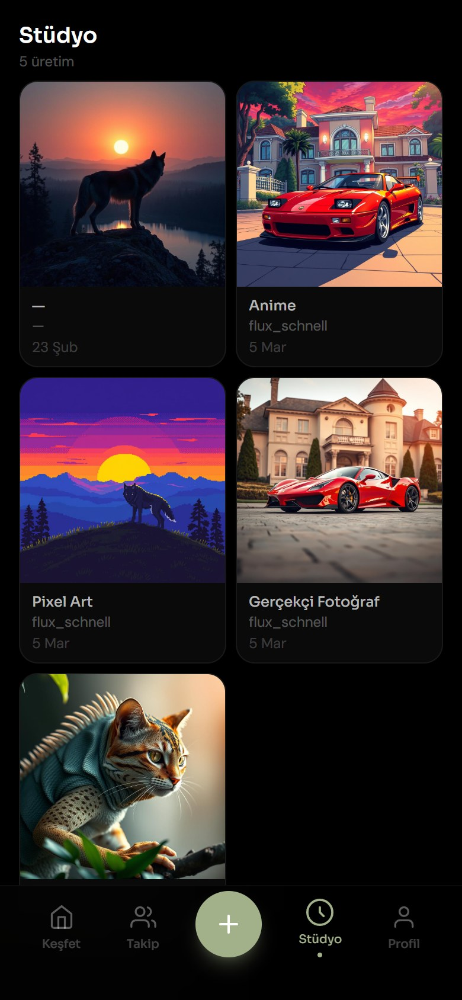
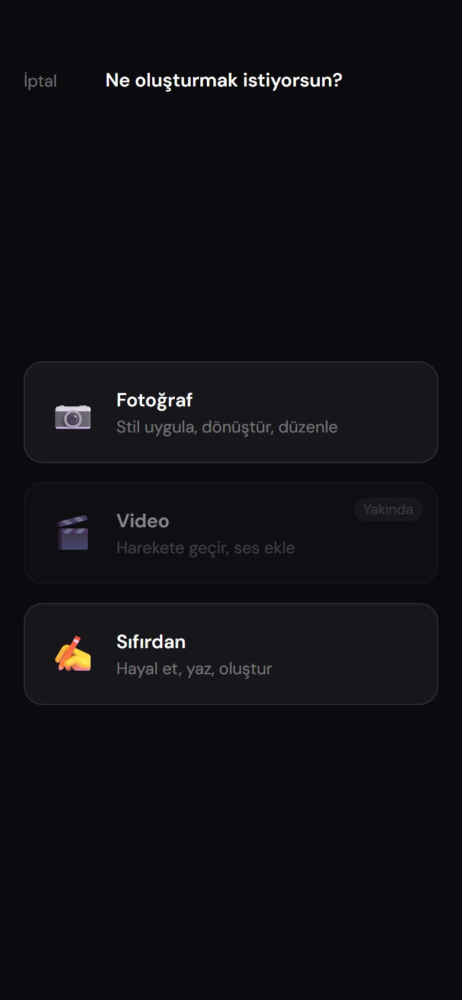

# Prompterest

A prompt gallery for AI image generation that runs on the web and on Android. Users browse prompts in a vertical feed, use an LLM to rewrite parts of a prompt, generate images with FLUX.1, and keep every change as a version.

I built it in 2026 as a personal project during my internship at Aslan Consulting.

<table>
<tr>
<td align="center"><br><sub>Feed</sub></td>
<td align="center"><br><sub>AI refactor: tap a phrase, pick an alternative</sub></td>
<td align="center"><br><sub>Studio: one prompt in several styles</sub></td>
<td align="center"><br><sub>Create flow</sub></td>
</tr>
</table>

<sub>The screenshots show the real UI running locally. The prompts and images are my own data, exported from the database. The AI providers aren't connected locally, so the refactor suggestions in the second screenshot are sample data.</sub>

> **Status:** The live demo ran on a VPS and is offline now. The code stays here as a portfolio project. The newer create flow (styles, templates, coins) is still in progress (see [Roadmap](#roadmap)).

## Features

- **Feed:** vertical, swipeable feed of public prompts with their latest image
- **AI refactor:** an LLM picks three phrases in a prompt and suggests alternatives you can swap in
- **Image generation:** FLUX.1-schnell renders the current prompt
- **Version history:** every saved change is a new version, and older ones stay accessible. Editing someone else's prompt saves a copy and leaves the original untouched.
- **Bookmarks, following feed and user profiles**
- **Android app:** the same React code base packaged with Capacitor, with haptics and status-bar integration

## Tech stack

| Layer | Technology |
|---|---|
| Frontend | React 18, TypeScript, Vite, Tailwind CSS, Framer Motion, Zustand |
| Mobile | Capacitor 6 (Android) |
| Backend | Node.js, Hono, Drizzle ORM |
| Database | Neon (serverless PostgreSQL) |
| Auth | JWT (jose), scrypt password hashing |
| AI | OpenRouter (primary LLM) → Hugging Face router (fallback), FLUX.1-schnell |
| Deploy | Docker Compose, Nginx |
| Tests | Vitest, Testing Library, SonarQube |

## Architecture

```
Browser / Android app
        │
        ▼
Nginx ── /*      → React SPA (static build)
      └─ /api/*  → Hono backend ──► Neon PostgreSQL
                         │
                         └─► OpenRouter / Hugging Face   (keys live only on the server)
```

The browser never calls the AI providers directly. It calls `/api/ai/refactor` and `/api/ai/image` with its JWT, and the backend adds the provider key from its environment.

## Security

A review before publishing turned up several issues. All of them are fixed in this repo:

- **Secrets:** AI provider keys used to be baked into the frontend bundle. They now stay in backend environment variables. There's no fallback JWT secret either: the server refuses to start without `JWT_SECRET`.
- **Authorization:** only the owner can add versions to a prompt. Private prompts return 404 to everyone else.
- **Passwords:** hashed with scrypt (N=2^17, r=8, p=1, the [OWASP minimum](https://cheatsheetseries.owasp.org/cheatsheets/Password_Storage_Cheat_Sheet.html)) and compared in constant time. Older SHA-256 hashes are upgraded on the next login.
- **Abuse limits:**
  - Login is rate-limited per IP and per account.
  - Registration is rate-limited per IP.
  - AI calls are rate-limited per user.
  - Request bodies are capped at 8 MB.
- **Input validation:** prompt fields are length-checked, and image URLs must be `data:image/…` or `https://`.
- **Errors and CORS:** internal error messages never reach the client. CORS only allows the known web, Android and dev origins.

The rate limiter keeps its counters in memory, which works for the single backend container in `docker-compose.yml`. Running several instances would need a shared store such as Redis.

## Getting started

Requirements: Node.js 20+ and a PostgreSQL database (Neon works).

```bash
cp .env.example backend/.env    # fill in DATABASE_URL, JWT_SECRET, HF_TOKEN, ...

cd backend
npm install
npm run db:push                 # create tables with Drizzle
npm run db:seed                 # image styles and templates
npm run dev                     # http://localhost:3000

cd ../frontend
npm install
npm run dev                     # http://localhost:5173
```

With Docker, set the same variables in `.env` and run `docker compose up --build`. Variables prefixed with `VITE_` end up in the public bundle, so never put secrets in them.

Android: `cd frontend && npm run cap:build:android`, then open the project in Android Studio with `npm run cap:open:android`.

## Tests

```bash
cd backend && npm test     # routes, auth, rate limiting, LLM output parsing
cd frontend && npm test    # components, screens, store
```

An earlier SonarQube scan (March 2026) passed the quality gate with 72% coverage, 1% duplication and A ratings for security, reliability and maintainability.

## Roadmap

- `/api/generate` (the style/template/coin-based create flow) still calls a placeholder provider in this commit.
- Coin purchases and weekly refills are stubs.
- Video mode is marked "coming soon" in the UI.

---

<sub>🇹🇷 Görüntü üretimi için prompt galerisi: web ve Android. Prompt'ları dikey akışta keşfedip LLM ile yeniden yazabilir, FLUX.1 ile görsel üretebilir ve her değişikliği sürüm olarak saklayabilirsiniz. Aslan Consulting stajım sırasında geliştirdiğim kişisel bir proje.</sub>
